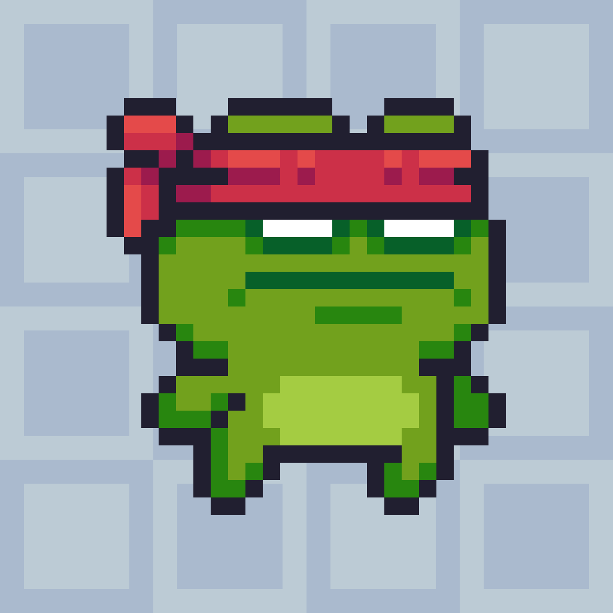
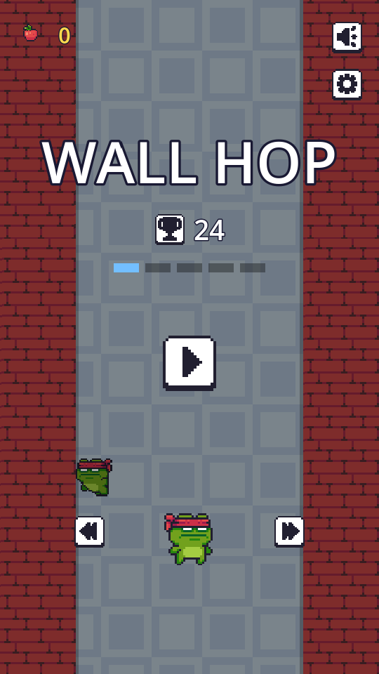
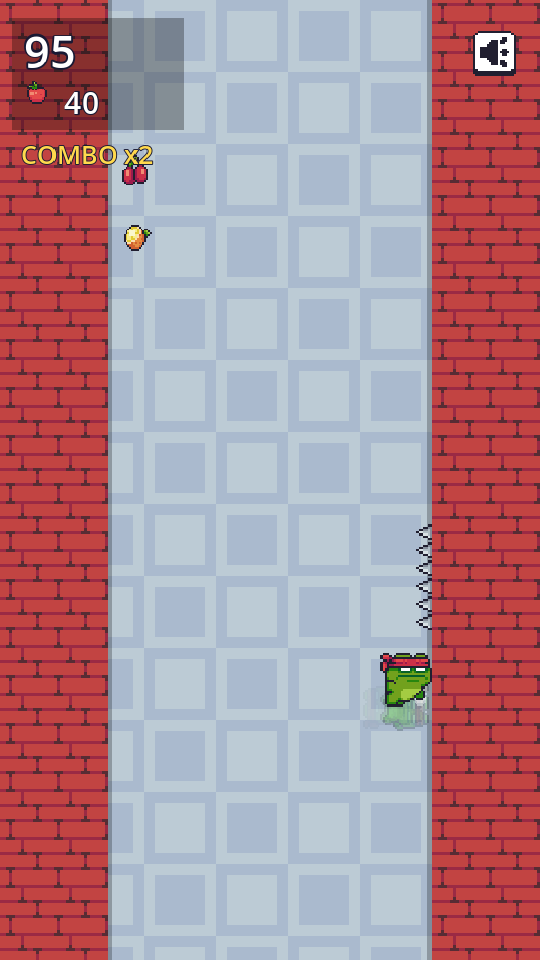
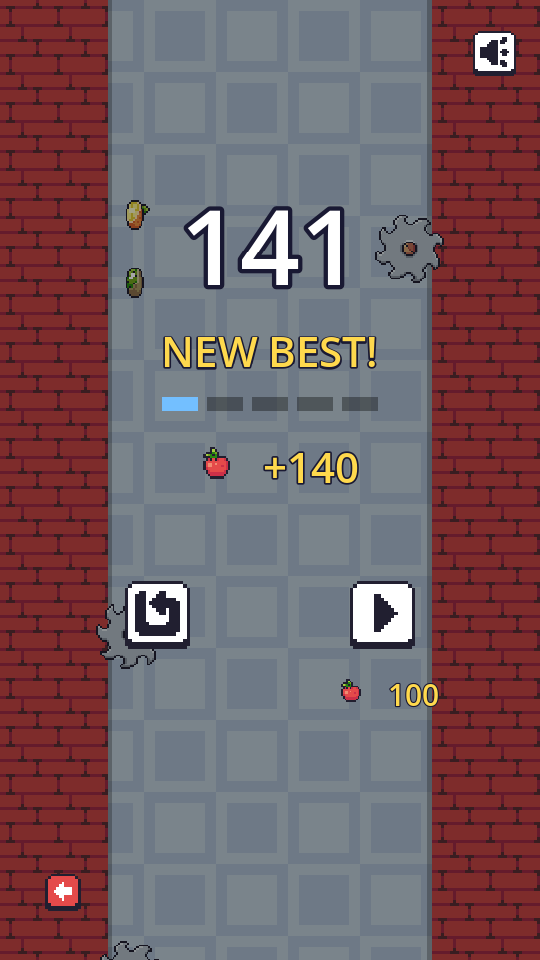

<div align="center">



# Wall Hop

**A one-tap pixel-art arcade game for iOS, built with Godot 4.**


</div>

Tap to hop to the opposite wall. Climb through five zones, land on hovering perches in the middle, dodge saws, spikes, fire and swinging spiked balls, collect fruit, beat your best score.

## Screenshots

<table>
  <tr>
    <td align="center"><br><sub>Title and character shop</sub></td>
    <td align="center"><br><sub>Hopping between walls</sub></td>
    <td align="center"><br><sub>Game over and continue</sub></td>
  </tr>
</table>

## Features

- 🐸 **One-tap controls**: a single tap flips you to the other wall, with a tap buffer for tight timing
- 🗺️ **Five zones**: Meadow, Saw Mill, Hot Forge, Sky Garden, Night Tower, each with its own hazards
- 🛸 **Perches**: hovering lifts in the middle (still, sliding, sinking or elevator) to rest on, eat fruit and wait for hazards to pass
- 🍎 **Natural fruit layouts** (trails, waves, swoops, clusters), 8 fruit with fixed values, and a shop with 4 characters, each with its own hop trail
- ♿ **Comfort options**: reduced-motion mode, calm background, break reminder
- 🧪 **Headless fairness test** that checks both walls are never deadly at once
- 🎵 CC0 chiptune music and sound effects

## Status

| Version | What's in it |
|---------|--------------|
| v0.1 | Playable core: wall hop, saws, spikes, fruit, score, best score, game over and retry, music and SFX |
| v0.2 | Five zones (Meadow, Saw Mill, Hot Forge, Sky Garden, Night Tower) with sliding saws, fire jets, swinging spiked balls; fruit combo; landing dust; mute button; headless simulation test |
| v0.3 | Icon-based title and game over screens, continue after game over (paid with fruit points), random fruit trails down the middle, smooth fireballs with glow and ember trail, score in the corner, fruit worth different points, character shop (4 characters, each with its own hop trail) |
| v0.3.1 | Comfort pass: no screen shake, still background, calmer walls, shorter eased hops, lower top speed, soft pulses, reduced-motion option, break reminder |
| v0.4.1 | Double tap for a high hop, fruit towers, perch landing ghost and timer dots, landing press and sounds, perch hold time per zone |
| v0.4 | Perches (hovering lifts) in the middle to land on: still, sliding left-right, sinking, or rising and falling like an elevator; fruit waves, swoops and clusters kept clear of hazards; shuffle-bag fruit; fixed fruit values 5-50, no combo |

Full history: [CHANGELOG.md](CHANGELOG.md).

Planned: more perch types (bounce pad, chained, crumbling, icy), pause, fruit bandits (enemies), full-screen iPhone layout, power-ups, missions, more zones, iOS release. See [docs/GAME_DESIGN.md](docs/GAME_DESIGN.md).

## Run it

1. Install Godot 4.x (Standard, GDScript): <https://godotengine.org/download>
2. Godot Project Manager -> **Import** -> select `project.godot`
3. Open the project once (Godot imports the assets), then press **F5**

Desktop controls: click or press Space (a second press early in a hop makes a high hop), M toggles sound, Left/Right browse characters and B buys on the title screen, R toggles reduced motion; after a game over, C continues and Esc goes back to the title. On a phone: tap anywhere, tap twice for a high hop; the speaker icon top-right mutes.

## Test it

A headless simulation plays several long runs and checks the fairness rules (for example, both walls are never deadly at the same time):

```
tests/run_tests.sh   # or: godot --headless --path . --script tests/sim_run.gd
```

Exit code 0 means pass.

## Project layout

```text
🐸 WallHop
├── 🎬 scenes
│   └── main.tscn            entry scene (just holds the script)
├── 📜 scripts
│   ├── main.gd              game flow, player, spawning, collisions, UI
│   ├── zones.gd             zone table: names, looks, hazard pattern weights
│   ├── hazard.gd            scrolling hazard / fruit with motion and hit shape
│   ├── catalog.gd           characters (prices, trail colours) and fruit values
│   └── art.gd               sprite-sheet to SpriteFrames helper
├── 🧪 tests
│   ├── sim_run.gd           headless simulation and fairness test
│   └── run_tests.sh         runs it; passes only on "PASS:"
├── 📖 docs
│   └── GAME_DESIGN.md       zones, rules, ideas and roadmap
├── 🎨 assets
│   ├── art                  Pixel Adventure 1 and 2 sprites (CC0)
│   │   ├── chars            playable characters
│   │   └── enemies          20 enemy sprite sets
│   ├── audio                OGG music and sound effects
│   └── icon                 app icon
├── ⚖️ Licenses              license info for third-party assets
├── 🙌 CREDITS.md            asset credits
└── ⚙️ project.godot         Godot 4 project settings
```

## Credits

See [CREDITS.md](CREDITS.md).
